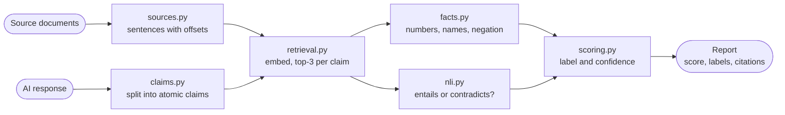

# Hallucination Detector

Checks an AI-generated answer against the documents it was supposed to be based on, one claim at a time. For every claim it reports a label, a confidence, the reason, and the exact source sentence used as evidence. For the whole answer it reports a 0–100 reliability score.

It runs locally on a CPU with three small open models. No API keys, no data leaves your machine.

```
[ 3] SUPPORTED    conf=1.00  Neil Armstrong commanded the mission.
      evidence [crew-and-return #0] (0.76): Neil Armstrong served as mission commander, and Buzz Aldrin was ...
[ 4] SUPPORTED    conf=0.97  He was joined on the surface by Buzz Aldrin about 19 minutes later.
      checked as: Neil Armstrong was joined on the surface by Buzz Aldrin about 19 minutes later.
      evidence [mission-summary #3] (0.72): Armstrong became the first person to walk on the Moon, followed by ...
[ 5] CONTRADICTED conf=1.00  The crew brought back about 45 kilograms of lunar samples.
      evidence [crew-and-return #1] (0.83): The astronauts collected about 21.5 kilograms of lunar samples.
      - number mismatch: claim says 45, evidence says 21.5
      - NLI contradiction p=0.99
[ 7] FABRICATED   conf=0.95  The landing site was chosen by a team of 300 geologists at Stanford University.
      - best evidence similarity 0.42
      - not found in source: 300, 'Stanford University'
[ 8] UNSUPPORTED  conf=0.88  Many historians consider it the greatest engineering achievement of the century.
      - best evidence similarity 0.16
      - no source sentence reaches support threshold 0.65

Claims: 8  (SUPPORTED=4, CONTRADICTED=1, FABRICATED=2, UNSUPPORTED=1)
Hallucination rate: 50%   Reliability score: 51.5/100
```

This is real output from `hallucheck detect --request examples/request.json` (five of its eight claims shown): one answer about Apollo 11 checked against two documents. Claim 3 was split out of *"Neil Armstrong, who commanded the mission, became the first person..."*, and the "He" in claim 4 was resolved to "Neil Armstrong" before checking.

## Contents

- [Installation](#installation)
- [Usage](#usage)
- [Architecture](#architecture)
- [Scoring methodology](#scoring-methodology)
- [Input and output](#input-and-output)
- [Results](#results)
- [Robustness](#robustness)
- [Limits](#limits)
- [Project layout](#project-layout)

## Installation

Requires Python 3.10 or later.

```bash
git clone https://github.com/jinu-kim-ai/hallucination-detector.git
cd hallucination-detector
pip install -e .
hallucheck download
```

`hallucheck download` fetches the three models once, about 380 MB in total, and confirms each one loads. After that, every run loads them from the local cache and needs no network.

| Model | Role | Size on disk |
|---|---|---|
| `en_core_web_sm` (spaCy) | sentence splitting, grammar, named entities | 15 MB |
| `sentence-transformers/all-MiniLM-L6-v2` | finding evidence | 87 MB |
| `cross-encoder/nli-deberta-v3-xsmall` | entailment vs contradiction | 281 MB |

Optional extras:

```bash
pip install -e ".[app]"     # the web UI
pip install -e ".[dev]"     # the test suite
```

## Usage

**Command line**

```bash
# a JSON request: one response, any number of sources
hallucheck detect --request examples/request.json

# plain text files (repeat --source for more documents)
hallucheck detect --answer examples/answer.txt --source examples/source.txt

# also write a highlighted HTML report and the full JSON result
hallucheck detect --request examples/request.json --html report.html --json report.json

# a lighter, faster setup without the NLI model
hallucheck --no-nli detect --request examples/request.json
```

**Python**

```python
from hallucination_detector import HallucinationDetector

detector = HallucinationDetector()
report = detector.detect(
    "The crew brought back about 45 kilograms of lunar samples.",
    [{"id": "nasa", "text": "The astronauts collected about 21.5 kilograms of lunar samples."}],
)
print(report.reliability_score)                 # 0.0
for v in report.verdicts:
    print(v.label, v.confidence, v.reasons)     # CONTRADICTED 1.0 [..., 'number mismatch: claim says 45, ...']
```

**Web UI**

```bash
streamlit run app.py
```

Paste a response and its sources, and get the score, a table of claims, and the highlighted report.

## Architecture



| Stage | Module | What it does |
|---|---|---|
| 1. Claims | `claims.py` | Splits the response into atomic claims with spaCy's grammar parse. Coordinated verbs and relative clauses become separate claims. A shared "not" is carried into every piece, so a split never reverses a claim. A leading *he / she / it / they* is resolved to what it refers to. Questions, pleasantries and markdown markers are dropped. |
| 2. Sources | `sources.py` | Splits every source document into sentences and records each one's character offsets, so a citation can point at the exact text. |
| 3. Retrieval | `retrieval.py` | Embeds source sentences once (cached per document) and finds the 3 most similar sentences for each claim, across all documents. |
| 4. Fact checks | `facts.py` | Compares the claim's numbers, named entities and negation with the evidence. Numbers are compared by what they count, so "14 percent" is never checked against "$412 million", and "$2.1 billion" matches "$2,100 million". |
| 5. Entailment | `nli.py` | A cross-encoder reads each (evidence, claim) pair and estimates whether the evidence entails or contradicts the claim. This catches errors that keep every name and number, such as *"Aldrin was the first to walk on the Moon"*. |
| 6. Scoring | `scoring.py` | Pure functions that turn those signals into a label and a confidence. No models, so every rule is unit-tested directly. |

`pipeline.py` wires the stages together and is the only module that knows their order. Each stage depends only on the shared data types (`schemas.py`) and settings (`config.py`), so a stage can be tested or replaced on its own.

## Scoring methodology

### Labels

| Label | Meaning |
|---|---|
| `SUPPORTED` | The evidence closely matches, and every number and name in the claim is grounded in a source. |
| `CONTRADICTED` | The evidence covers the same fact and disagrees. |
| `FABRICATED` | The claim adds specific numbers or names that appear in no source. |
| `UNSUPPORTED` | No source backs the claim: opinion, speculation, or off-topic. |

### Decision rules

For each claim, let `s` be the cosine similarity of its best evidence sentence, and `E` / `C` the NLI probabilities of entailment / contradiction. The first matching rule wins:

| # | Condition | Label |
|---|---|---|
| 1 | `s ≥ 0.70` and (a number, name or negation conflict, or `C ≥ 0.70`) | `CONTRADICTED` |
| 2 | the claim has numbers or names found in no source | `FABRICATED` |
| 3 | `s ≥ 0.65`, or (`E ≥ 0.70` and `s ≥ 0.45`) | `SUPPORTED` |
| 4 | otherwise | `UNSUPPORTED` |

The reasoning behind the rules:

- **Contradiction needs close evidence (`s ≥ 0.70`).** Only a sentence about the same fact can contradict a claim. Loosely related text with different numbers means the claim is fabricated, not contradicted.
- **Only the best sentence can contradict.** A neighboring sentence about a different fact would otherwise contradict true claims: a sentence about the 1903 Physics prize "contradicts" a correct claim about the 1911 Chemistry prize.
- **Any cited sentence can support.** Entailment from any of the top 3 sentences counts, so a loose paraphrase (`s` between 0.45 and 0.65) is supported when the NLI model agrees.
- **Notation is not contradiction.** When a claim and its evidence differ only in how a number is written, the NLI model is re-run with both numbers in one notation.
- **Ambiguous pronouns are not guessed.** In *"Marie Curie married Pierre Curie. She died in 1906."*, "She" is left unresolved. Such a claim is `SUPPORTED` only if the supporting sentence names the earlier subject and not the other person.

### Confidence

Each label has a confidence between 0 and 1:

| Label | Confidence |
|---|---|
| `CONTRADICTED` | `min(1, 0.55 + 0.15 × conflicts + 0.30 × (s − 0.45) / 0.55)` |
| `FABRICATED` | `min(1, 0.55 + 0.10 × invented facts + 0.35 × (1 − s))` |
| `SUPPORTED` | `max(0.5 + 0.5 × min(1, (s − 0.45) / 0.55), E)` |
| `UNSUPPORTED` | `0.5 + 0.5 × (0.65 − s) / 0.65` |

These are heuristics, not calibrated probabilities. They rank claims sensibly (two independent conflicts are more convincing than one) but 0.9 does not mean "right 90% of the time".

### Reliability score

```
reliability = 100 × (sum of confidence over SUPPORTED claims) / (sum of confidence over all claims)
```

A confident contradiction lowers the score more than a borderline one. A claim repeated in the answer counts once. The score is `null` when the answer has nothing to check or is not in English.

Every threshold above is a field in [`config.py`](src/hallucination_detector/config.py), validated when the detector is built, and has a command-line flag (`hallucheck --help`).

## Input and output

**Request** (`--request`):

```json
{
  "response": "The crew brought back about 45 kilograms of lunar samples.",
  "sources": [
    {"id": "crew-and-return", "title": "Crew roles and return to Earth", "text": "..."}
  ]
}
```

**Result** (`--json`), one entry per claim:

```json
{
  "reliability_score": 51.5,
  "hallucination_rate": 0.5,
  "counts": {"SUPPORTED": 4, "CONTRADICTED": 1, "FABRICATED": 2, "UNSUPPORTED": 1},
  "warnings": [],
  "claims": [
    {
      "id": 5,
      "text": "The crew brought back about 45 kilograms of lunar samples.",
      "response_span": [221, 278],
      "label": "CONTRADICTED",
      "confidence": 1.0,
      "best_similarity": 0.832,
      "reasons": [
        "best evidence similarity 0.83",
        "number mismatch: claim says 45, evidence says 21.5",
        "NLI contradiction p=0.99"
      ],
      "citations": [
        {
          "source_id": "crew-and-return",
          "sentence_index": 1,
          "source_span": [88, 151],
          "quote": "The astronauts collected about 21.5 kilograms of lunar samples.",
          "similarity": 0.832,
          "nli": {"contradiction": 0.995, "entailment": 0.001, "neutral": 0.005}
        }
      ]
    }
  ],
  "config": {"embedder": "all-MiniLM-L6-v2", "use_nli": true, "support_threshold": 0.65}
}
```

The full result for the example is in [`examples/report.json`](examples/report.json); `claims` and `config` are shortened here.

- `response_span` and `source_span` are character offsets into the original text, so a UI can highlight both sides. [`examples/report.html`](examples/report.html) does exactly that.
- `citations` lists only sentences similar enough to count as evidence. It is empty when there are none, and `best_similarity` still reports the closest match.
- `checked_as` appears when a pronoun was resolved; `duplicate_of` when a claim repeats an earlier one.
- `config` records every setting behind the result, so any report can be reproduced.

## Results

"Positive" means hallucination: any label other than `SUPPORTED`.

| Set | Claims | Configuration | Precision | Recall | F1 | Exact label |
|---|---|---|---|---|---|---|
| Development (`data/`) | 50 | embeddings + fact checks | 0.964 | 0.900 | 0.931 | 90% |
| Development (`data/`) | 50 | + NLI (default) | 1.000 | 1.000 | 1.000 | 98% |
| **Held-out (`data/heldout/`)** | 40 | embeddings + fact checks | 0.895 | 0.810 | 0.850 | 75% |
| **Held-out (`data/heldout/`)** | 40 | + NLI (default) | 0.905 | 0.905 | **0.905** | 82.5% |

Reproduce with `hallucheck evaluate --data data` and `hallucheck evaluate --data data/heldout`.

**How much to trust these numbers.** The thresholds were tuned on the development set, so its scores are inflated; the held-out rows are the ones to read. The held-out set covers 5 different domains, including claims that need two documents, and was never used for tuning. It first scored F1 0.884 and reached 0.905 after a round of bug fixes that were driven by code review, not by its claims. Even so, its errors had been written up by then, so it is no longer a pure first look. Both sets are small and were written by the detector's author. Treat every number as an estimate, not a benchmark result.

The NLI model adds about 5 points of F1 on held-out data, all from recall.

### Sample cases

[`examples/cases/`](examples/cases/) holds 8 realistic AI answers with the true label of every claim (72 claims). For each of four domains (a medication leaflet, a store's return policy, an earnings report, a research study) there is one fully factual answer and one with planted errors: a wrong number, a wrong name, a reversed meaning, an invented detail, and an unsupported opinion. All names are invented.

```bash
hallucheck cases --verbose
```

| | Result |
|---|---|
| Agrees on hallucination vs supported | 86% of claims |
| Exact label | 78% of claims |
| Reliability score of the factual answers | 71 to 94 |
| Reliability score of the hallucinated answers | 50 to 55 |

Every factual answer scores well above its hallucinated twin. The misses are mostly loose paraphrases of long sentences, opinions that sit close to a factual sentence, and one swapped place name the entity tagger does not recognize.

### Known errors on held-out data

| Kind | Claim | Cause |
|---|---|---|
| False alarm | "Mount Everest's summit is 8,849 meters..." | the possessive `'s` stops the name matching the source |
| False alarm | "...the first modern Olympics in Athens in 1896." | "Olympics" and "Olympic Games" read as different events |
| Missed | "Photosynthesis uses oxygen ... and releases carbon dioxide" | the roles are swapped but every word is in the source |
| Missed | "The Vega 3 is the best battery on the market." | an opinion that sits close to a factual sentence |
| Wrong label, still flagged | a wrong year, in two claims | similarity just under 0.70: `FABRICATED` instead of `CONTRADICTED` |
| Wrong label, still flagged | "...most important chemical process on Earth." | "Earth" read as an invented name |

These are left unfixed on purpose, so the held-out set is not tuned on.

## Robustness

**Speed** (one CPU, Intel i9-13900KF):

| Workload | Time |
|---|---|
| The example request (8 claims), with NLI | about 0.5 s, plus about 10 s on the first call to load the models |
| The same, without NLI | about 0.2 s |
| A 250,000-character source document | about 11 s for the first claim, 0.1 s for each later one |
| A 2.85-million-character source document | about 105 s for the first claim, 0.5 s for each later one |
| A 1.2-million-character response | about 26 s without NLI |

Run time grows linearly with input length. Long text is parsed in bounded chunks, source sentences are embedded once and cached, and a run-on sentence of over 120 words is checked in parts, with a warning.

**Models.** A model already in the local cache is loaded without contacting the network, so a slow or missing connection does not affect later runs. If a model is missing and cannot be downloaded, the error says which model, why, and what to do.

**Input.** Empty responses, empty or missing sources, non-English text, duplicate claims and conflicting sources each produce a normal result with a warning. They never crash.

**Errors.** A missing file, invalid JSON, a wrong encoding, an out-of-range threshold or a malformed dataset ends with a one-line message and exit status 2:

```
$ hallucheck detect --request missing.json
hallucheck: error: missing.json: No such file or directory
```

In Python, a value of the wrong type raises a `TypeError` that names the argument, and an invalid setting raises a `ValueError` when the detector is built.

**Tests.** 889 tests, one file per module plus end-to-end, robustness and sample-case suites:

```bash
pytest -q
```

Eight further tests are marked as strict expected failures. They pin the one documented gap in the language check (below), so a future fix will be noticed.

## Limits

- **English only.** Other languages are detected and returned with a warning and no score. One gap: a single short German or Spanish sentence containing a capitalized word can pass as English.
- **Heuristic claim splitting.** It depends on spaCy's small parser. When a clause cannot be attached with confidence (*"the price of oil, which ..."*), the sentence is kept whole rather than guessed.
- **Conservative pronouns.** After a second person or thing has been named (*"married Pierre Curie"*, *"leads Tesla"*), a later *he / she / it* is left unresolved. A true *he / she* claim can then come out `UNSUPPORTED`.
- **Units are not compared.** "21.5 pounds" against "21.5 kilograms" passes the number check and relies on the NLI model.
- **Sentence-level evidence.** A claim that needs two distant sentences to verify may score lower than it should.
- **Conflicting sources.** The claim is labeled by the closest sentence and a "sources conflict" warning is added. The detector does not decide which source is right.
- **Hedges are checked.** *"I think Apollo 11 launched in 1970"* is still checked as a claim, because a hedge does not make a false statement true.
- **Small evaluation sets.** See [Results](#results).

## Project layout

```
src/hallucination_detector/
  config.py      every model name and threshold, validated on construction
  schemas.py     SourceDocument, Claim, Citation, ClaimVerdict, Report
  models.py      model loading: local cache first, clear errors
  chunking.py    cutting long text into bounded pieces with exact offsets
  claims.py      stage 1: claim decomposition
  sources.py     stage 2: document loading and sentence splitting
  retrieval.py   stage 3: embeddings and top-k search
  facts.py       stage 4: number, name and negation checks
  nli.py         stage 5: cross-encoder entailment
  scoring.py     stage 6: label rules and confidence
  pipeline.py    HallucinationDetector: wires the stages together
  report.py      terminal, JSON and HTML output
  evaluate.py    precision / recall / F1, per-domain metrics, confusion matrix
  cases.py       sample cases: load, run, compare with the true labels
  cli.py         the `hallucheck` command
app.py           Streamlit UI
tests/           889 tests
data/            development set, and data/heldout/ (never used for tuning)
examples/        a two-document request, its reports, and the sample cases
results/         saved evaluation runs
```
